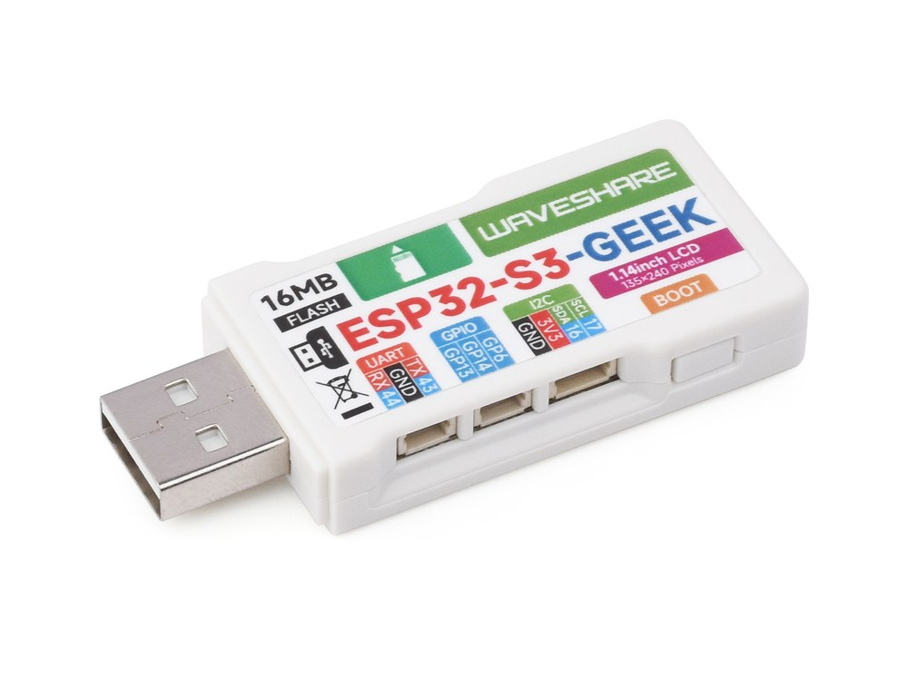

  <h1>ESP32-S3-GEEK</h1>
  
<strong>ESP32-S3 development board with a 1.14-inch LCD, USB-A and microSD</strong>

  
<strong>English</strong> | <a href="README_ZH.md">简体中文</a>

  

  

    <a href="https://www.waveshare.com/esp32-s3-geek.htm">🛒 Product</a> &middot;
    <a href="https://docs.waveshare.com/ESP32-S3-GEEK/Firmware-Flashing/">📦 Firmware</a> &middot;
    <a href="examples/esp-idf/">🧩 ESP-IDF</a> &middot;
    <a href="examples/arduino/examples/">🔧 Arduino</a> &middot;
    <a href="https://docs.waveshare.com/ESP32-S3-GEEK/">📖 Documentation</a>
  

  

---

## ✨ Overview

The ESP32-S3-GEEK is a Wi-Fi and Bluetooth development board with native USB. This repository contains Arduino, ESP-IDF and MicroPython examples.

| Feature | Device or interface |
| --- | --- |
| MCU | ESP32-S3 |
| Memory | 16 MB Flash, 2 MB PSRAM |
| Display | 1.14″ IPS LCD, 135 × 240, SPI, ST7789 |
| Interfaces | USB-A, microSD, I²C, UART, GPIO |

## 📦 Quick Start

1. Get the official firmware and flash addresses from the [flashing guide](https://docs.waveshare.com/ESP32-S3-GEEK/Firmware-Flashing/).
2. Hold BOOT while plugging the board into USB, then release the button and flash it.
3. Reconnect the board over USB to start the firmware.

## 🧪 Examples

### ESP-IDF

| Example | Main feature |
| --- | --- |
| [Wireless_USB_flash_drive](examples/esp-idf/Wireless_USB_flash_drive/) | USB mass storage and Wi-Fi file access |

### Arduino

| Example | Main feature |
| --- | --- |
| [01_OneButton](examples/arduino/examples/01_OneButton/) | Button gestures |
| [02_ADC_Read](examples/arduino/examples/02_ADC_Read/) | ADC sampling |
| [03_IIC_BME68X_Sensor](examples/arduino/examples/03_IIC_BME68X_Sensor/) | BME68x over I²C |
| [04_UART0](examples/arduino/examples/04_UART0/) | Serial echo |
| [05_LCD_Button](examples/arduino/examples/05_LCD_Button/) | LCD image and backlight control |
| [06_LCD_Time](examples/arduino/examples/06_LCD_Time/) | Network time on the LCD |
| [07_SD_Test](examples/arduino/examples/07_SD_Test/) | microSD filesystem operations |
| [08_SD_LCD](examples/arduino/examples/08_SD_LCD/) | JPEG display from microSD |
| [09_BLE_LCD](examples/arduino/examples/09_BLE_LCD/) | BLE data on the LCD |
| [10_BLE_UART](examples/arduino/examples/10_BLE_UART/) | BLE serial bridge |
| [11_BLE_Keyboard](examples/arduino/examples/11_BLE_Keyboard/) | BLE keyboard |
| [12_WIFI_AP_LCD](examples/arduino/examples/12_WIFI_AP_LCD/) | Wi-Fi access point on the LCD |
| [13_WIFI_TCP_Client](examples/arduino/examples/13_WIFI_TCP_Client/) | Wi-Fi TCP client |
| [14_WIFI_TCP_Server](examples/arduino/examples/14_WIFI_TCP_Server/) | Wi-Fi TCP server |
| [15_WIFI_Web_Server](examples/arduino/examples/15_WIFI_Web_Server/) | Wi-Fi web server |
| [16_MQTT_sub_pub](examples/arduino/examples/16_MQTT_sub_pub/) | MQTT publish and subscribe |
| [17_MQTT_BLE_Keyboard](examples/arduino/examples/17_MQTT_BLE_Keyboard/) | MQTT and BLE keyboard integration |

The required libraries are in [examples/arduino/libraries](examples/arduino/libraries/).

### MicroPython

The [MicroPython examples](examples/micropython/) cover LCD, SD, UART, Wi-Fi and BLE.

## 🛠️ Development Environment

| Framework | Version | Examples |
| --- | --- | ---: |
| ESP-IDF | `v5.3.1` | 1 |
| Arduino-ESP32 | `2.0.7` | 17 |

In Arduino IDE, select **ESP32S3 Dev Module**, enable **USB CDC On Boot**, and select **16MB Flash**, **QSPI PSRAM** and the **16M Flash (3MB APP/9.9MB FATFS)** partition. Set the serial monitor to 115200.

## 📚 Resources

- [Schematic](hardware/schematic/)
- [Product page](https://www.waveshare.com/esp32-s3-geek.htm)
- [Wiki](https://docs.waveshare.com/ESP32-S3-GEEK/)

## 🤝 Support

- [Waveshare support](https://service.waveshare.com/)

## 📄 License

This repository is licensed under Apache License 2.0. See [LICENSE](LICENSE).