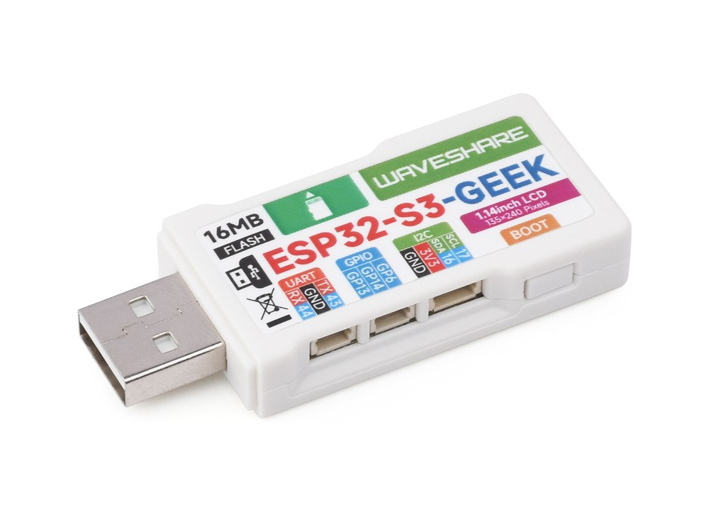

  <h1>ESP32-S3-GEEK</h1>
  
<strong>带 1.14 英寸 LCD、USB-A 和 microSD 的 ESP32-S3 开发板</strong>

  
<a href="README.md">English</a> | <strong>简体中文</strong>

  

  

    <a href="https://www.waveshare.com/esp32-s3-geek.htm">🛒 产品</a> &middot;
    <a href="https://docs.waveshare.net/ESP32-S3-GEEK/Firmware-Flashing/">📦 固件</a> &middot;
    <a href="examples/esp-idf/">🧩 ESP-IDF</a> &middot;
    <a href="examples/arduino/examples/">🔧 Arduino</a> &middot;
    <a href="https://docs.waveshare.net/ESP32-S3-GEEK/">📖 文档</a>
  

  

---

## ✨ 概述

ESP32-S3-GEEK 是一款带原生 USB 接口的 Wi-Fi 和蓝牙开发板。本仓库提供 Arduino、ESP-IDF 和 MicroPython 示例。

| 功能 | 器件或接口 |
| --- | --- |
| MCU | ESP32-S3 |
| 存储器 | 16 MB Flash, 2 MB PSRAM |
| 显示 | 1.14″ IPS LCD, 135 × 240, SPI, ST7789 |
| 接口 | USB-A, microSD, I²C, UART, GPIO |

## 📦 快速开始

1. 从[固件烧录指南](https://docs.waveshare.net/ESP32-S3-GEEK/Firmware-Flashing/)获取官方固件并按指南选择烧录地址。
2. 按住 BOOT 键，将开发板插入 USB，松开后开始烧录。
3. 烧录结束后重新插拔开发板以启动。

## 🧪 示例

### ESP-IDF

| 示例 | 主要功能 |
| --- | --- |
| [Wireless_USB_flash_drive](examples/esp-idf/Wireless_USB_flash_drive/README_ZH.md) | USB 大容量存储与 Wi-Fi 文件访问 |

### Arduino

| 示例 | 主要功能 |
| --- | --- |
| [01_OneButton](examples/arduino/examples/01_OneButton/README_ZH.md) | 按键手势 |
| [02_ADC_Read](examples/arduino/examples/02_ADC_Read/README_ZH.md) | ADC 采样 |
| [03_IIC_BME68X_Sensor](examples/arduino/examples/03_IIC_BME68X_Sensor/README_ZH.md) | I²C 读取 BME68x |
| [04_UART0](examples/arduino/examples/04_UART0/README_ZH.md) | 串口回显 |
| [05_LCD_Button](examples/arduino/examples/05_LCD_Button/README_ZH.md) | LCD 图像和背光控制 |
| [06_LCD_Time](examples/arduino/examples/06_LCD_Time/README_ZH.md) | LCD 网络时间 |
| [07_SD_Test](examples/arduino/examples/07_SD_Test/README_ZH.md) | microSD 文件操作 |
| [08_SD_LCD](examples/arduino/examples/08_SD_LCD/README_ZH.md) | 显示 microSD 中的 JPEG |
| [09_BLE_LCD](examples/arduino/examples/09_BLE_LCD/README_ZH.md) | LCD 显示 BLE 数据 |
| [10_BLE_UART](examples/arduino/examples/10_BLE_UART/README_ZH.md) | BLE 串口通信 |
| [11_BLE_Keyboard](examples/arduino/examples/11_BLE_Keyboard/README_ZH.md) | BLE 键盘 |
| [12_WIFI_AP_LCD](examples/arduino/examples/12_WIFI_AP_LCD/README_ZH.md) | LCD 显示 Wi-Fi 热点 |
| [13_WIFI_TCP_Client](examples/arduino/examples/13_WIFI_TCP_Client/README_ZH.md) | Wi-Fi TCP 客户端 |
| [14_WIFI_TCP_Server](examples/arduino/examples/14_WIFI_TCP_Server/README_ZH.md) | Wi-Fi TCP 服务端 |
| [15_WIFI_Web_Server](examples/arduino/examples/15_WIFI_Web_Server/README_ZH.md) | Wi-Fi 网页服务器 |
| [16_MQTT_sub_pub](examples/arduino/examples/16_MQTT_sub_pub/README_ZH.md) | MQTT 发布和订阅 |
| [17_MQTT_BLE_Keyboard](examples/arduino/examples/17_MQTT_BLE_Keyboard/README_ZH.md) | MQTT 与 BLE 键盘联动 |

所需库位于 [examples/arduino/libraries](examples/arduino/libraries/)。

### MicroPython

[MicroPython 示例](examples/micropython/README_ZH.md)涵盖 LCD、SD 卡、UART、Wi-Fi 和 BLE。

## 🛠️ 开发环境

| 开发框架 | 版本 | 示例数 |
| --- | --- | ---: |
| ESP-IDF | `v5.3.1` | 1 |
| Arduino-ESP32 | `2.0.7` | 17 |

Arduino 选择 **ESP32S3 Dev Module**，启用 **USB CDC On Boot**，选择 **16MB Flash**、**QSPI PSRAM** 和 **16M Flash (3MB APP/9.9MB FATFS)** 分区。串口监视器设为 115200。

## 📚 资料

- [原理图](hardware/schematic/)
- [产品页](https://www.waveshare.com/esp32-s3-geek.htm)
- [Wiki](https://docs.waveshare.net/ESP32-S3-GEEK/)

## 🤝 支持

- [微雪技术支持](https://docs.waveshare.net/ESP32-S3-GEEK/Technical-Support/)

## 📄 许可证

本仓库采用 Apache License 2.0，详见 [LICENSE](LICENSE)。